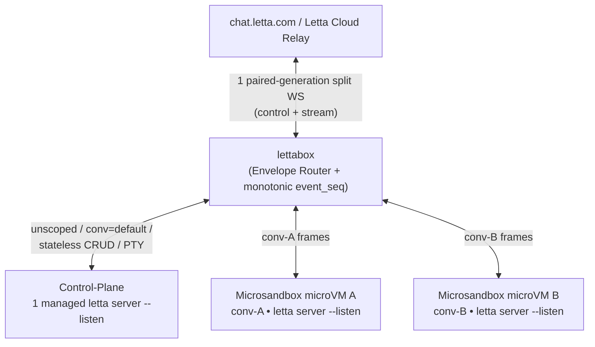

# `lettabox`

Expose a **single unified remote environment** to `chat.letta.com` while isolating every Letta conversation (`conversation_id`) inside its own ephemeral **Microsandbox (`msb`) microVM** running an unmodified `letta server`.

Works on **macOS (Apple Silicon)** and **Linux (KVM)** using the official multi-arch `ghcr.io/letta-ai/letta-code:latest` OCI image, with **host-side secret injection** so your `LETTA_API_KEY` stays on the host and never enters the microVM.

## Prerequisites

- macOS on Apple Silicon, or Linux with KVM
- [Bun](https://bun.sh) 1.4+
- [`letta`](https://github.com/letta-ai/letta-code) CLI (`npm install -g @letta-ai/letta-code`)

## Install

Install globally from GitHub with Bun (includes the SDK-bundled Microsandbox runtime—no separate `msb` install required):

```sh
# Latest release
bun install -g github:kaaloo/lettabox#v0.2.0

# Or latest main
bun install -g github:kaaloo/lettabox
```

Or install from a local clone for development:

```sh
git clone https://github.com/kaaloo/lettabox.git
cd lettabox
bun install --frozen-lockfile
bun link
```

## Quickstart

```sh
lettabox
```

On startup, `lettabox`:

1. Loads your Letta token from `LETTA_API_KEY` or `~/.letta/settings.json` (in an interactive terminal, automatically runs `letta login` if you aren't signed in yet).
2. Starts a managed local control-plane `letta server`.
3. Verifies the matching Microsandbox runtime under `~/.lettabox/microsandbox` (isolated from any existing `~/.microsandbox` install), pre-pulls `ghcr.io/letta-ai/letta-code:latest` if not cached, and pre-warms a standby microVM so the first conversation hands off immediately.
4. Connects to Letta Cloud—your computer appears under **Computers** on `chat.letta.com` with a `📦` status subtitle (e.g. `📦 MacBook Pro · Apple M5 Pro · 24 GB`).

Every conversation gets its own isolated microVM and is automatically reaped after 30 minutes of inactivity (never mid-turn).

To inspect active microVMs from a local clone (or query `/status` with `--status-port`):

```sh
MSB_HOME="$HOME/.lettabox/microsandbox" bunx msb list --label letta-sandbox.managed=true
```

## macOS Menubar Integration

`lettabox` is a drop-in replacement for `letta server` in desktop wrappers such as [`letta-server-macos-menubar`](https://tangled.org/kaaloo.tngl.sh/letta-server-macos-menubar):

- Supports `--computer-name <name>` and `--lifecycle-output jsonl` (`lettaLifecycleProtocol: 1` state transitions: `starting` → `ready` ↔ `working` / `reconnecting` / `error` / `stopped`).
- Exposes an optional loopback-only HTTP status server via `--status-port`:

```sh
lettabox --computer-name "My MacBook Pro" --status-port 4590
```

- `GET http://127.0.0.1:4590/healthz` → `200 ok`
- `GET http://127.0.0.1:4590/status` → JSON snapshot (`connectionName`, `sandboxMode`, `upstreamReady`, `uptimeMs`, `activeSandboxes[]`)

> [!WARNING]
> The status server has no authentication and binds to loopback (`127.0.0.1`) only. Do not expose it to a network or reverse proxy.

## Configuration

Run `lettabox --help` for the full flag list.

| Flag / Alias                | Environment Variable      | Default                              | Description                                                                 |
| --------------------------- | ------------------------- | ------------------------------------ | --------------------------------------------------------------------------- |
| `--name`, `--computer-name` | `LETTA_CONNECTION_NAME`   | `lettabox-<hostname>`                | Display name shown in `chat.letta.com`                                      |
| `--mode`                    | `SANDBOX_MODE`            | `microsandbox` (CLI) / `static`      | `microsandbox` (`msb`) or `static` (`WORKER_URLS`)                          |
| `--image`                   | `SANDBOX_IMAGE`           | `ghcr.io/letta-ai/letta-code:latest` | OCI image for ephemeral conversation microVMs                               |
| `--memory`                  | `SANDBOX_MEMORY_LIMIT`    | `2G`                                 | Memory limit per microVM                                                    |
| `--cpus`                    | `SANDBOX_CPU_LIMIT`       | `2`                                  | vCPU limit per microVM                                                      |
| `--idle-timeout`            | `SANDBOX_IDLE_TIMEOUT_MS` | `1800000` (30m)                      | Idle duration before an inactive conversation microVM is reaped             |
| —                           | `SANDBOX_WARM_POOL_SIZE`  | `1`                                  | Number of pre-warmed standby microVMs kept ready (`0` to disable)           |
| `--control-plane-url`       | `CONTROL_PLANE_URL`       | _(auto-spawned)_                     | Attach to an existing `letta server --listen` instead of auto-spawning      |
| `--status-port`             | `STATUS_PORT`             | _(disabled)_                         | Expose local `http://127.0.0.1:<port>/status` JSON endpoint                 |
| `--lifecycle-output jsonl`  | —                         | _(disabled)_                         | Emit `lettaLifecycleProtocol: 1` JSONL state transitions on stdout          |
| `--msb-path`                | `MSB_PATH`                | _(SDK-bundled runtime)_              | Advanced override for the `msb` runtime binary                              |
| —                           | `MSB_HOME`                | `~/.lettabox/microsandbox`           | Microsandbox runtime/state home, isolated from existing `~/.microsandbox`   |
| `--letta-bin`               | `LETTA_BIN`               | `letta`                              | Path to the `letta` binary for the managed control-plane and `letta login`  |
| `--debug`                   | `DEBUG_FRAMES`            | `false`                              | Log routed frame envelope summaries and `event_seq` rewrites                |
| —                           | `LETTA_API_KEY`           | `~/.letta/settings.json`             | Letta Cloud API key (auto-loaded from `letta login` settings if unset)      |
| —                           | `MSB_SECRET_INJECTION`    | `true`                               | Inject `LETTA_API_KEY` at the host network boundary for HTTPS Letta servers |
| —                           | `WORKER_URLS`             | _(empty)_                            | Comma-separated static worker URLs when `--mode static`                     |

`.env.example` documents placeholder-only local configuration. Never commit real credentials; `.env`, key material, and `private/` are gitignored.

## Architecture



### Design Docs

- [Architecture & Protocol RFC for Letta](docs/rfc-letta-server-sandbox.md) — design overview, live Protocol V2 findings, security model, and upstream integration options.
- [Milestone 1: Protocol Inspection Notes](docs/milestone-1-protocol-notes.md) — verified upstream `letta-ai/letta-code` transport, registration, split-channel, heartbeat, routing envelope, and `event_seq` findings.
- [Original POC Specification](docs/poc-spec.md) — initial goals and milestones.

## Development

Prerequisites: Bun `1.4.4` (pinned in `package.json`), [uv](https://docs.astral.sh/uv/) (for `pre-commit`), and Go (for the Gitleaks hook).

```sh
bun install --frozen-lockfile
uv tool install pre-commit
pre-commit install --install-hooks
```

Run the same checks as CI:

```sh
bunx biome ci .
bun run typecheck
bun test
bun run smoke
```

Use `bun run check --write` to apply Biome formatting and lint fixes. There is no separate build step; Bun executes the TypeScript CLI directly.

To run the security hooks manually:

```sh
pre-commit run gitleaks
pre-commit run cve-lite --all-files --hook-stage pre-push
```

### CI & Releases

- **CI:** PRs and `main` pushes run Biome, TypeScript, Bun tests, a CLI smoke check, full-history Gitleaks, and OSV-Scanner (also scheduled weekly).
- **Dependencies:** Bun enforces a seven-day minimum release age, saves exact versions, and restricts lifecycle scripts to `trustedDependencies`. Dependabot covers Bun, pre-commit, and GitHub Actions with the same cooldown.
- **Releases:** `release-please` maintains versioned GitHub Release PRs on `main` (this repo runs locally and pulls the official Letta Code OCI image at runtime).

## Security

Report vulnerabilities privately through GitHub's **Security → Advisories → Report a vulnerability** flow. See [SECURITY.md](SECURITY.md) for scope and reporting details.

## License

MIT; see [LICENSE](LICENSE).
