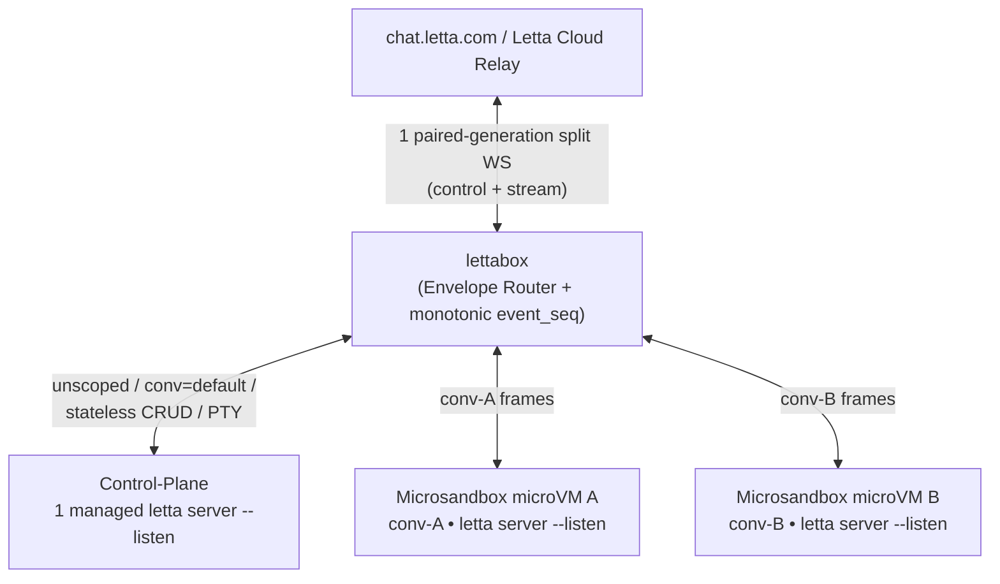

# `lettabox`

Expose a **single unified remote environment** to `chat.letta.com` while isolating every Letta conversation (`conversation_id`) inside its own ephemeral **Microsandbox (`msb`) microVM** running an unmodified `letta server`.

Works cross-platform on **macOS (Apple Silicon)** and **Linux (KVM)** using the official multi-arch `ghcr.io/letta-ai/letta-code:latest` OCI image—with **host-side secret injection** so your `LETTA_API_KEY` stays on the host and never enters the microVM.

## Architecture



## Quickstart (One-Line CLI)

Prerequisites:
- macOS on Apple Silicon, or Linux with KVM
- [Bun](https://bun.sh)
- [`letta`](https://github.com/letta-ai/letta-code) CLI (`npm install -g @letta-ai/letta-code`, authenticated via `letta login` or `LETTA_API_KEY`)

```zsh
# Install lettabox and the SDK-bundled Microsandbox runtime
bun install

# Start lettabox (auto-spawns control-plane + loads auth from ~/.letta/settings.json)
bun run start -- --name my-lettabox
```

Select **`my-lettabox`** in `chat.letta.com`. Every conversation lazily boots its own isolated microVM and is automatically reaped after 30 minutes of inactivity (never mid-turn). The first boot pulls the OCI image automatically.

Microsandbox runtime and state live in `~/.lettabox/microsandbox` by default, isolated from any existing `~/.microsandbox` installation. Set `MSB_HOME` to use a different home.

Inspect active microVMs at any time with the locally installed SDK CLI shim:

```zsh
MSB_HOME="$HOME/.lettabox/microsandbox" bunx msb list --label letta-sandbox.managed=true
```

## macOS Menubar Integration

`lettabox` exposes an optional local HTTP status server for integration with desktop wrappers such as [`letta-server-macos-menubar`](https://tangled.org/kaaloo.tngl.sh/letta-server-macos-menubar):

```zsh
bun run start -- --name my-mac --status-port 4590
```

- `GET http://127.0.0.1:4590/healthz` → `200 ok`
- `GET http://127.0.0.1:4590/status` → JSON snapshot (`connectionName`, `sandboxMode`, `upstreamReady`, `uptimeMs`, `activeSandboxes[]`)

## CLI Options & Environment Variables

```zsh
bun run start -- --help
```

| Flag | Environment Variable | Default | Description |
| --- | --- | --- | --- |
| `--name` | `LETTA_CONNECTION_NAME` | `lettabox-<hostname>` | Display name shown in `chat.letta.com` |
| `--mode` | `SANDBOX_MODE` | `microsandbox` (CLI) / `static` | `microsandbox` (`msb`) or `static` (`WORKER_URLS`) |
| `--image` | `SANDBOX_IMAGE` | `ghcr.io/letta-ai/letta-code:latest` | OCI image for ephemeral conversation microVMs |
| `--memory` | `SANDBOX_MEMORY_LIMIT` | `2G` | Memory limit per microVM |
| `--cpus` | `SANDBOX_CPU_LIMIT` | `2` | vCPU limit per microVM |
| `--idle-timeout` | `SANDBOX_IDLE_TIMEOUT_MS` | `1800000` (30m) | Idle duration before an idle microVM is reaped |
| `--control-plane-url` | `CONTROL_PLANE_URL` | *(auto-spawned)* | Attach to an existing `letta server --listen` instead of auto-spawning |
| `--status-port` | `STATUS_PORT` | *(disabled)* | Expose local `http://127.0.0.1:<port>/status` JSON endpoint |
| `--msb-path` | `MSB_PATH` | *(SDK-bundled runtime)* | Advanced override for the `msb` runtime binary |
| — | `MSB_HOME` | `~/.lettabox/microsandbox` | Microsandbox runtime/state home, independent of existing CLI installations |
| `--letta-bin` | `LETTA_BIN` | `letta` | Path to the `letta` binary for the managed control-plane |
| `--debug` | `DEBUG_FRAMES` | `false` | Log routed frame envelope summaries and `event_seq` rewrites |
| — | `LETTA_API_KEY` | `~/.letta/settings.json` | Letta Cloud API key (auto-loaded from `letta login` settings if unset) |
| — | `MSB_SECRET_INJECTION` | `true` | Inject `LETTA_API_KEY` at the host network boundary for HTTPS Letta servers |
| — | `WORKER_URLS` | *(empty)* | Comma-separated static worker URLs when `--mode static` |

## Documentation

- [Architecture & Protocol RFC for Letta](docs/rfc-letta-server-sandbox.md) — design overview, live Protocol V2 findings, security model, and upstream integration options.
- [Milestone 1: Protocol Inspection Notes](docs/milestone-1-protocol-notes.md) — verified upstream `letta-ai/letta-code` transport, registration, split-channel, heartbeat, routing envelope, and `event_seq` findings.
- [Original POC Specification](docs/poc-spec.md) — initial goals and milestones.

## Development

```zsh
bun install
bun run typecheck
bun test
```
