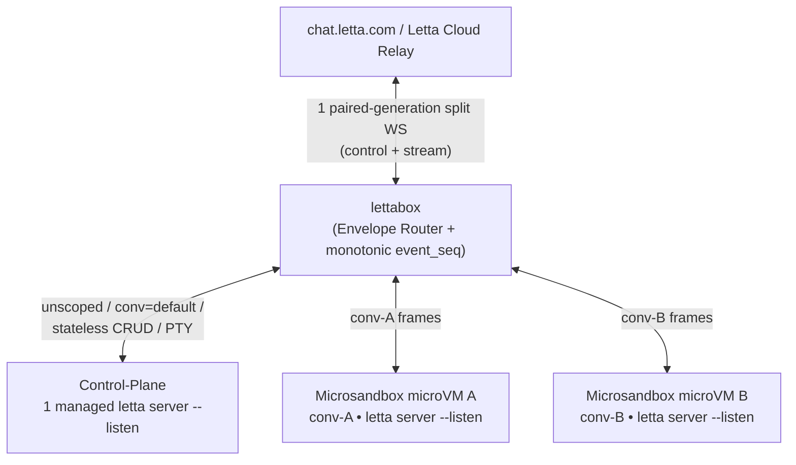

# `lettabox`

Expose a **single unified remote environment** to `chat.letta.com` while isolating every Letta conversation (`conversation_id`) inside its own ephemeral **Microsandbox (`msb`) microVM** running an unmodified `letta server`.

Works cross-platform on **macOS (Apple Silicon)** and **Linux (KVM)** using the official multi-arch `ghcr.io/letta-ai/letta-code:latest` OCI image—with **host-side secret injection** so your `LETTA_API_KEY` stays on the host and never enters the microVM.

## Architecture



## Quickstart (One-Line CLI)

Prerequisites:

- macOS on Apple Silicon, or Linux with KVM
- [Bun](https://bun.sh) 1.4.4
- [`letta`](https://github.com/letta-ai/letta-code) CLI (`npm install -g @letta-ai/letta-code`, authenticated via `letta login` or `LETTA_API_KEY`)

```sh
# Install lettabox and the SDK-bundled Microsandbox runtime
bun install --frozen-lockfile

# Start lettabox (auto-spawns the control plane and loads auth from ~/.letta/settings.json)
bun run start -- --name my-lettabox
```

Select **`my-lettabox`** in `chat.letta.com`. Every conversation lazily boots its own isolated microVM and is automatically reaped after 30 minutes of inactivity (never mid-turn). The first boot pulls the OCI image automatically.

Microsandbox runtime and state live in `~/.lettabox/microsandbox` by default, isolated from any existing `~/.microsandbox` installation. Set `MSB_HOME` to use a different home.

Inspect active microVMs at any time with the locally installed SDK CLI shim:

```sh
MSB_HOME="$HOME/.lettabox/microsandbox" bunx msb list --label letta-sandbox.managed=true
```

## macOS Menubar Integration

`lettabox` exposes an optional local HTTP status server for integration with desktop wrappers such as [`letta-server-macos-menubar`](https://tangled.org/kaaloo.tngl.sh/letta-server-macos-menubar):

```sh
bun run start -- --name my-mac --status-port 4590
```

- `GET http://127.0.0.1:4590/healthz` → `200 ok`
- `GET http://127.0.0.1:4590/status` → JSON snapshot (`connectionName`, `sandboxMode`, `upstreamReady`, `uptimeMs`, `activeSandboxes[]`)

The status server has no authentication and must remain bound to its loopback-only default. Do not expose it to a network or reverse proxy.

## CLI Options & Environment Variables

```sh
bun run start -- --help
```

| Flag                  | Environment Variable      | Default                              | Description                                                                 |
| --------------------- | ------------------------- | ------------------------------------ | --------------------------------------------------------------------------- |
| `--name`              | `LETTA_CONNECTION_NAME`   | `lettabox-<hostname>`                | Display name shown in `chat.letta.com`                                      |
| `--mode`              | `SANDBOX_MODE`            | `microsandbox` (CLI) / `static`      | `microsandbox` (`msb`) or `static` (`WORKER_URLS`)                          |
| `--image`             | `SANDBOX_IMAGE`           | `ghcr.io/letta-ai/letta-code:latest` | OCI image for ephemeral conversation microVMs                               |
| `--memory`            | `SANDBOX_MEMORY_LIMIT`    | `2G`                                 | Memory limit per microVM                                                    |
| `--cpus`              | `SANDBOX_CPU_LIMIT`       | `2`                                  | vCPU limit per microVM                                                      |
| `--idle-timeout`      | `SANDBOX_IDLE_TIMEOUT_MS` | `1800000` (30m)                      | Idle duration before an idle microVM is reaped                              |
| `--control-plane-url` | `CONTROL_PLANE_URL`       | _(auto-spawned)_                     | Attach to an existing `letta server --listen` instead of auto-spawning      |
| `--status-port`       | `STATUS_PORT`             | _(disabled)_                         | Expose local `http://127.0.0.1:<port>/status` JSON endpoint                 |
| `--msb-path`          | `MSB_PATH`                | _(SDK-bundled runtime)_              | Advanced override for the `msb` runtime binary                              |
| —                     | `MSB_HOME`                | `~/.lettabox/microsandbox`           | Microsandbox runtime/state home, independent of existing CLI installations  |
| `--letta-bin`         | `LETTA_BIN`               | `letta`                              | Path to the `letta` binary for the managed control-plane                    |
| `--debug`             | `DEBUG_FRAMES`            | `false`                              | Log routed frame envelope summaries and `event_seq` rewrites                |
| —                     | `LETTA_API_KEY`           | `~/.letta/settings.json`             | Letta Cloud API key (auto-loaded from `letta login` settings if unset)      |
| —                     | `MSB_SECRET_INJECTION`    | `true`                               | Inject `LETTA_API_KEY` at the host network boundary for HTTPS Letta servers |
| —                     | `WORKER_URLS`             | _(empty)_                            | Comma-separated static worker URLs when `--mode static`                     |

`.env.example` documents placeholder-only local configuration. Never commit real credentials; `.env`, key material, and the `private/` output directory are gitignored.

## Documentation

- [Architecture & Protocol RFC for Letta](docs/rfc-letta-server-sandbox.md) — design overview, live Protocol V2 findings, security model, and upstream integration options.
- [Milestone 1: Protocol Inspection Notes](docs/milestone-1-protocol-notes.md) — verified upstream `letta-ai/letta-code` transport, registration, split-channel, heartbeat, routing envelope, and `event_seq` findings.
- [Original POC Specification](docs/poc-spec.md) — initial goals and milestones.

## Repository structure

- `.github/`: CI, dependency updates, and release automation
- `docs/`: protocol findings, design documents, and the original POC specification
- `src/`: CLI, multiplexer, control plane, and Microsandbox provider
- `tests/`: unit and integration tests using Bun's test runner
- `private/`: gitignored local audit evidence and other sensitive outputs; create on demand

## Development

Install the pinned package manager and dependencies, then activate both hook stages. The Gitleaks hook requires Go; install the pre-commit CLI with [uv](https://docs.astral.sh/uv/).

```sh
bun install --frozen-lockfile
uv tool install pre-commit
pre-commit install --install-hooks
```

Run the same quality gates as CI:

```sh
bunx biome ci .
bun run typecheck
bun test
bun run smoke
```

Use `bun run check --write` to apply Biome's safe formatting and lint fixes. There is no separate application build step; Bun executes the TypeScript CLI directly.

Verify the security hooks explicitly:

```sh
pre-commit run gitleaks
pre-commit run cve-lite --all-files --hook-stage pre-push
```

## CI, dependencies, and releases

Pull requests and `main` pushes run Biome, TypeScript, Bun tests, a CLI smoke check, full-history Gitleaks, and OSV-Scanner. OSV also runs weekly; while SARIF upload is disabled, findings remain available in workflow logs and artifacts.

Bun enforces a seven-day minimum release age for new dependency resolutions, saves exact versions, and restricts lifecycle scripts to `trustedDependencies`. Dependabot covers Bun, pre-commit, and GitHub Actions with the same cooldown. The repository owner reviews dependency and vulnerability reports weekly; automatic merging is disabled.

release-please maintains release PRs after merges to `main`, starting from the existing `0.1.0` baseline. Release PRs use the same review and merge policy as other changes; setup does not publish artifacts automatically.

This repository has no hosted deployment or container build. It runs locally and pulls the official Letta Code OCI image at runtime.

## Security

Report vulnerabilities privately through GitHub's **Security → Advisories → Report a vulnerability** flow. See [SECURITY.md](SECURITY.md) for scope and reporting details.

## License

MIT; see [LICENSE](LICENSE).
