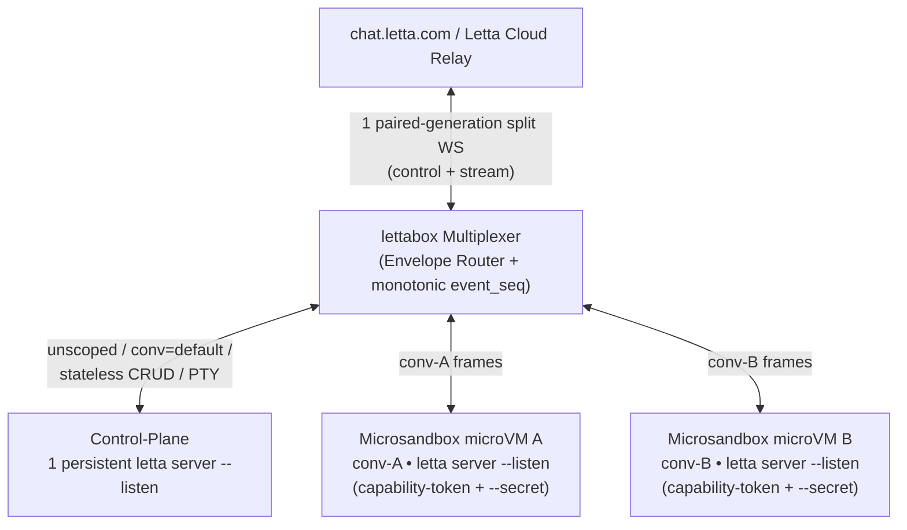

# RFC: Per-Conversation MicroVM Isolation for `letta server` (`lettabox`)

> **AI Usage Disclosure (per `letta-ai/letta-code` `AI_POLICY.md`):** This RFC and the accompanying `lettabox` prototype were developed interactively by a human author with AI coding assistance (Antigravity). All protocol behavior, microVM runs, and live `chat.letta.com` sessions were verified by the author.

## Summary

Today, connecting a self-hosted machine (macOS laptop or Linux VPS) to `chat.letta.com` via `letta server` runs every conversation inside the same host environment. Isolating conversations currently requires either:
- Paying per-hour for Letta Cloud Sandboxes (\$0.24/hr), or
- Running multiple named `letta server` processes, which floods the `chat.letta.com` environment picker.

**`lettabox`** demonstrates a third model: expose a **single unified remote environment** to `chat.letta.com` while lazily isolating every `conversation_id` inside its own ephemeral **Microsandbox (`msb`) hardware microVM** running an unmodified `ghcr.io/letta-ai/letta-code:latest` image—with **zero modifications to `letta-code`**.

We're sharing this working prototype to ask the Letta team whether this belongs:
- **Upstream in `letta-code`** (e.g., `letta server --sandbox microsandbox`),
- **Behind a small upstream hook** (keeping the provider external), or
- **As a standalone community tool** (e.g., paired with `letta-server-macos-menubar`).

---

## Architecture



### Key Design Properties

1. **Control-Plane vs. Conversation-Plane Split**
   - **Control-plane:** One lightweight persistent `letta server --listen` handles computer-level frames (`list_models`, `sync` with `conv=default`, stateless conversation CRUD like `conversation_messages_list`, and PTY commands). Browsing history in `chat.letta.com` never cold-starts a microVM.
   - **Conversation-plane:** Any conversation-scoped frame (`runtime_start`, `sync`, `change_device_state`, `input`, `abort_message`, etc.) lazily spawns an isolated `msb` microVM for that `conversation_id` running unmodified `ghcr.io/letta-ai/letta-code:latest`.

2. **Opaque Envelope Routing (Zero Command-Vocabulary Drift)**
   - Inspects only transport-level fields: `type` (for the 5 split-channel stream types + stateless CRUD/PTY allowlist), `runtime.conversation_id` / top-level `conversation_id`, `request_id`, and `event_seq`.
   - Unknown future commands/events forward opaquely without multiplexer updates.
   - Rewrites outbound `event_seq` into a single strictly monotonic stream (`1, 2, 3, ...`) per upstream connection while leaving `idempotency_key` untouched.
   - Correlates worker-initiated `control_request` ↔ upstream `control_response` by `request_id` even when `control_response` omits `runtime.conversation_id`.

3. **Defense-in-Depth Security (Host-Side Secret Injection)**
   - **Hardware isolation:** Real microVMs on both macOS (Apple Silicon Hypervisor.framework) and Linux (KVM) via [`microsandbox`](https://github.com/superradcompany/microsandbox) (`msb`).
   - **API key never enters the guest VM:** Uses `msb`'s `--secret LETTA_API_KEY:headers=[Authorization]@api.letta.com` so the guest only sees a placeholder and the real `LETTA_API_KEY` is injected at the host TLS boundary exclusively for `api.letta.com`.
   - **Authenticated loopback transport:** Each microVM binds to a random host loopback port (`127.0.0.1:<port>`) and requires a fresh 256-bit per-VM `--ws-auth capability-token` (written to a `0600` file and unset from guest env before `exec letta server`).

4. **Lifecycle & Reliability**
   - **Busy-turn reaper guard:** Tracks `input_accepted` → `turn_finished` / `update_loop_status` so an actively working microVM is never reaped mid-turn during long builds or test runs.
   - **Dead-VM eviction:** If a microVM crashes or OOMs, bounded downstream reconnects evict the dead slot, run `msb rm --force`, and transparently respawn on the next frame.

---

## Live Protocol V2 Observations

During live end-to-end testing against `chat.letta.com`, we observed several behaviors that informed the router:
- Existing conversations often begin with `sync` → `change_device_state` → `input` directly (without `runtime_start`), so lazy provisioning must trigger on *any* conversation-scoped frame, not only `runtime_start`.
- Initial environment sync sends `sync` with `runtime.conversation_id = "default"`, which must route to the control-plane rather than spawning a sandbox.
- `GET /app-server-info` returned unexpected keys for `lettaCodeVersion` / `supported_commands` compared to our initial inspection—documenting its stable JSON schema would help external wrappers register full capabilities accurately.

---

## Try It in 60 Seconds

```zsh
# Pre-cache the official multi-arch Letta Code image once
msb pull ghcr.io/letta-ai/letta-code:latest

# Clone and run (auto-spawns control-plane + reads auth from ~/.letta/settings.json or LETTA_API_KEY)
git clone https://github.com/kaaloo/letta-sandbox.git lettabox
cd lettabox && bun install
bun run start -- --name my-lettabox --debug
```

Then select **`my-lettabox`** in `chat.letta.com`, open two conversations, and inspect the running microVMs with:

```zsh
msb ls --label letta-sandbox.managed=true
```

---

## Discussion Questions for the Letta Team

1. **Native vs. External:** Would you be interested in a PR adding `letta server --sandbox microsandbox` directly inside `letta-ai/letta-code` (reusing `letta-code`'s existing relay/auth/heartbeat lifecycle instead of duplicating it in a proxy), or do you prefer keeping sandbox multiplexing external?
2. **Protocol/Extension Seams:** If kept external (e.g. as a community CLI + macOS menubar integration via `letta-server-macos-menubar`), would you be open to documenting the `/app-server-info` capability schema and any future envelope-routing invariants?
